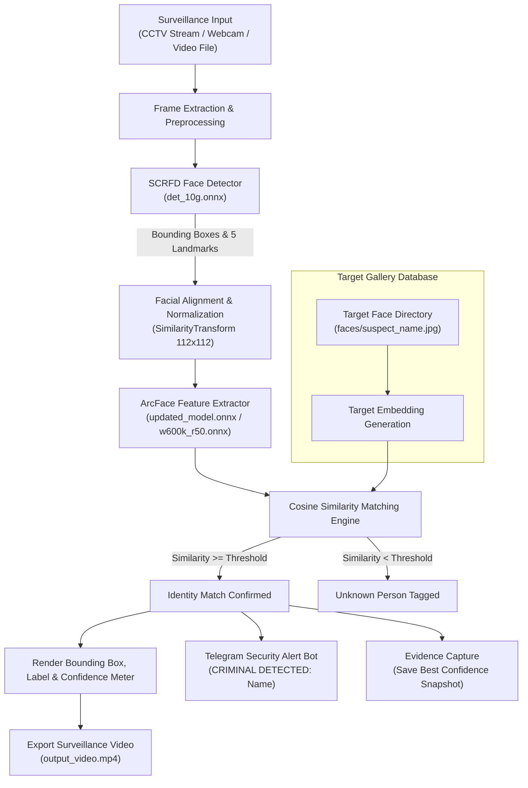

<div align="center">

# 🚨 CrimePatrol: Criminal Face Re-Identification & Surveillance Alert System

[](https://www.python.org/)
[](https://pytorch.org/)
[](https://onnxruntime.ai/)
[](https://opencv.org/)
[](https://telegram.org/)
[](https://opensource.org/licenses/MIT)

*An intelligent, end-to-end automated surveillance and face re-identification pipeline featuring high-precision face detection via **SCRFD**, deep angular margin representation via **ArcFace**, a custom **PyTorch-to-ONNX fine-tuning pipeline**, and instant **Telegram security dispatch alerts**.*

---

[Key Features](#-key-features) •
[Architecture](#-system-architecture) •
[Quick Start](#-quick-start) •
[Model Weights](#-model-weights) •
[Telegram Alerts](#-telegram-alert-bot-setup) •
[Fine-Tuning](#-custom-identity-fine-tuning) •
[CLI Options](#-cli-reference)

---

</div>

## 📌 Overview

**CrimePatrol** is an automated face re-identification surveillance framework designed for security personnel, smart campuses, and public safety monitoring. Traditional CCTV systems require tedious manual inspection, creating bottlenecks and delays when locating persons of interest.

This system provides an automated pipeline that:
1. **Detects** faces in surveillance video streams in real-time using lightweight, high-accuracy **SCRFD** (Sample and Computation Redistribution for Efficient Face Detection).
2. **Aligns and Extracts** normalized 512-dimensional facial feature vectors using **ArcFace** (Additive Angular Margin Loss).
3. **Re-identifies** suspects by computing cosine similarity against a gallery of reference identities.
4. **Dispatches Real-Time Alerts** via a dedicated **Telegram Bot** to security subscribers immediately upon detection.
5. **Logs Evidence** by automatically capturing and saving the clearest, highest-confidence frame per detected identity (`detected_<name>.jpg`) along with an annotated output video.
6. **Supports Custom Fine-Tuning**: Includes an end-to-end workflow to fine-tune ArcFace backbones on custom target datasets in PyTorch and export back into optimized ONNX graphs.

---

## ✨ Key Features

- ⚡ **High-Speed SCRFD Detection**: Accurately detects faces across varied scales, angles, distances, and occlusions in surveillance feeds.
- 🎯 **Discriminative ArcFace Embeddings**: Employs angular margin loss to reliably separate identities even under challenging lighting.
- 🔄 **Custom PyTorch ⟷ ONNX Training Pipeline**:
  - Convert pretrained ONNX models into PyTorch computation graphs (`onnx2pytorch`).
  - Freeze backbones and train custom classification heads using Automatic Mixed Precision (`torch.cuda.amp`).
  - Export fine-tuned weights back into ONNX format for accelerated deployment.
  - Modify ONNX model graphs for dynamic batch inference.
- 📲 **Automated Telegram Security Alerts**:
  - Broadcasts `CRIMINAL DETECTED: <Name>` messages directly to subscribed security personnel.
  - Automatically manages subscriber chat IDs via `/start` commands.
  - Fail-safe design: network timeouts or unconfigured tokens will never crash the surveillance video loop.
- 📸 **Automatic Best-Frame Evidence Logging**:
  - Tracks detections across video frames and saves the highest-confidence snapshot per target (`detected_<Name>.jpg`).
- 🎥 **Annotated Video Recording**:
  - Automatically records processed feeds with bounding boxes, names, confidence ratings, and similarity meters (`output_video.mp4`).
- 💻 **Hardware Accelerated**: Supports both NVIDIA CUDA GPU acceleration and CPU execution providers via ONNX Runtime.

---

## 🏗️ System Architecture



---

## 📂 Repository Structure

```
criminal-face-detection-and-recognition/
│
├── assets/                          # Media assets and documentation files
│   └── .gitkeep
│
├── faces/                           # Target gallery database (reference face images)
│   ├── .gitkeep                     # Add your target images here (e.g., suspect1.jpg)
│   └── README.md                    # Target gallery setup instructions
│
├── fine_tune/                       # ArcFace fine-tuning & ONNX export pipeline
│   ├── test.py                      # Training script: fine-tunes ArcFace on custom datasets
│   ├── conversion.py                # Exports fine-tuned PyTorch checkpoint back to ONNX
│   ├── modify_onnx.py               # Patches ONNX graph to enable dynamic batch sizes
│   ├── arcface_finetuned_best.pth   # Fine-tuned PyTorch model weights (tracked via Git LFS)
│   └── updated_model.onnx           # Exported fine-tuned ONNX model (tracked via Git LFS)
│
├── src/                             # Core application source code
│   ├── models/                      # Deep learning inference wrappers
│   │   ├── __init__.py
│   │   ├── scrfd.py                 # SCRFD detector with NMS & landmark extraction
│   │   ├── arcface.py               # ArcFace feature extractor with landmark alignment
│   │   ├── helpers.py               # Image processing & geometry utilities
│   │   └── weights/                 # ONNX model weights directory
│   │       ├── det_10g.onnx         # SCRFD detection weights (tracked via Git LFS)
│   │       └── .gitkeep
│   ├── utils/                       # Shared utility functions
│   │   ├── __init__.py
│   │   └── helpers.py               # Landmark alignment, similarity, and visualization
│   ├── main.py                      # Surveillance inference execution entry point
│   └── telegram_bot.py              # Telegram alert dispatcher and subscriber management
│
├── .env.example                     # Environment template for Telegram bot credentials
├── .gitattributes                   # Git LFS tracking configuration for large model files
├── .gitignore                       # Git ignore rules for datasets, credentials, and outputs
├── download.sh                      # Shell script to download pretrained ONNX weights (Linux/macOS)
├── download_weights.py              # Cross-platform Python script to download ONNX weights
├── requirements.txt                 # Project dependencies
└── README.md                        # Documentation
```

---

## 🚀 Quick Start

### 1. Prerequisites
- **Python**: 3.8, 3.9, 3.10, or 3.11
- **CUDA** (optional, recommended): NVIDIA CUDA 11.8+ or 12.x for GPU acceleration

### 2. Clone the Repository
```bash
git clone https://github.com/subhodeepmodak/criminal-face-detection-and-recognition.git
cd criminal-face-detection-and-recognition
```

### 3. Create and Activate Virtual Environment
```bash
# Windows (PowerShell)
python -m venv venv
.\venv\Scripts\activate

# Linux / macOS
python3 -m venv venv
source venv/bin/activate
```

### 4. Install Dependencies
```bash
pip install --upgrade pip
pip install -r requirements.txt
```

> **GPU Acceleration (Optional)**:
> For NVIDIA GPU inference with ONNX Runtime:
> ```bash
> pip uninstall -y onnxruntime
> pip install onnxruntime-gpu
> ```

---

## 📦 Model Weights

The system utilizes two primary models:
1. **Face Detector**: SCRFD (Sample and Computation Redistribution for Efficient Face Detection)
2. **Face Recognizer**: ArcFace (ResNet-50 / MobileFace)

### Automatic Download
Run the included cross-platform downloader:
```bash
python download_weights.py
```
Or on Linux/macOS:
```bash
bash download.sh
```

### Manual Download Links

| Model Name | Backbone | Weight File | Size | Primary Purpose |
| :--- | :--- | :--- | :---: | :--- |
| **SCRFD 10G** *(Recommended)* | ResNet | [`det_10g.onnx`](https://github.com/yakhyo/face-reidentification/releases/download/v0.0.1/det_10g.onnx) | 16.9 MB | High-accuracy face detection & landmarks |
| **SCRFD 2.5G** | MobileNet | [`det_2.5g.onnx`](https://github.com/yakhyo/face-reidentification/releases/download/v0.0.1/det_2.5g.onnx) | 3.14 MB | Balanced detection for edge devices |
| **SCRFD 500M** | Lightweight | [`det_500m.onnx`](https://github.com/yakhyo/face-reidentification/releases/download/v0.0.1/det_500m.onnx) | 2.41 MB | Ultra-fast detection for low-power CPUs |
| **ArcFace ResNet-50** | ResNet-50 | [`w600k_r50.onnx`](https://github.com/yakhyo/face-reidentification/releases/download/v0.0.1/w600k_r50.onnx) | 166 MB | Deep 512-d face recognition embedding |
| **ArcFace MobileFace** | MobileFaceNet | [`w600k_mbf.onnx`](https://github.com/yakhyo/face-reidentification/releases/download/v0.0.1/w600k_mbf.onnx) | 13.0 MB | Compact recognition model |
| **Custom Fine-Tuned ArcFace** | ResNet-50 | `fine_tune/updated_model.onnx` | 174 MB | Fine-tuned on custom identity gallery |

---

## 📲 Telegram Alert Bot Setup

CrimePatrol integrates directly with Telegram to broadcast real-time alerts whenever a target face is identified.

### Step 1: Create Your Bot
1. Open Telegram and search for [@BotFather](https://t.me/BotFather).
2. Send `/newbot` and follow the prompts to choose a name and username.
3. Copy the **HTTP API Bot Token** provided.

### Step 2: Configure Environment Variables
Create a `.env` file in the project root:
```bash
cp .env.example .env
```
Add your bot token:
```env
TOKEN="your_telegram_bot_token_here"
```

### Step 3: Subscribe to Security Alerts
1. Open your bot in Telegram and send `/start`.
2. Run the subscriber registration script:
   ```bash
   python src/telegram_bot.py
   ```
   Select option `1` to fetch updates and register your chat ID.
3. When a target is identified during surveillance, all subscribed chat IDs receive an instant dispatch alert.

---

## 🖥️ Running Surveillance Inference

### 1. Populate the Target Face Gallery
Place reference photos of your target individuals in the `faces/` directory:
```
faces/
├── Suspect_1.jpg
├── Suspect_2.jpg
└── Target_A.jpg
```
The file basename (e.g., `Suspect_1` from `Suspect_1.jpg`) is automatically used as the display name on bounding boxes and Telegram alerts.

### 2. Run on Recorded CCTV Video
```bash
python src/main.py \
  --det-weight src/models/weights/det_10g.onnx \
  --rec-weight fine_tune/updated_model.onnx \
  --faces-dir faces \
  --source path/to/cctv_footage.mp4 \
  --save-video output_video.mp4
```

### 3. Run on Live Webcam
```bash
python src/main.py \
  --det-weight src/models/weights/det_10g.onnx \
  --rec-weight fine_tune/updated_model.onnx \
  --faces-dir faces \
  --source 0
```

### 4. Running Offline / Benchmarking (Disable Telegram Alerts)
```bash
python src/main.py \
  --det-weight src/models/weights/det_10g.onnx \
  --rec-weight fine_tune/updated_model.onnx \
  --faces-dir faces \
  --source 0 \
  --disable-telegram
```

---

## 🛠️ Custom Identity Fine-Tuning

To specialize the ArcFace feature extractor for a specific set of target individuals:

### Step 1: Prepare Training Data
Organize your dataset inside `fine_tune/dataset/` with subfolders for each identity:
```
fine_tune/dataset/
├── Identity_A/
│   ├── img1.jpg
│   └── img2.jpg
└── Identity_B/
    ├── img1.jpg
    └── img2.jpg
```

### Step 2: Train the Model
```bash
python fine_tune/test.py \
  --dataset fine_tune/dataset \
  --onnx-base src/models/weights/w600k_r50.onnx \
  --epochs 50 \
  --batch-size 16 \
  --lr 0.0001 \
  --output-pth fine_tune/arcface_finetuned_best.pth
```
*The script freezes the backbone layers, updates the final linear layer for custom identities, and optimizes with Automatic Mixed Precision (`torch.cuda.amp`).*

### Step 3: Export Back to ONNX
Convert the fine-tuned PyTorch checkpoint back to an ONNX graph for high-speed inference:
```bash
python fine_tune/conversion.py \
  --onnx-base src/models/weights/w600k_r50.onnx \
  --pth-weights fine_tune/arcface_finetuned_final.pth \
  --output-onnx fine_tune/updated_model.onnx
```

### Step 4: Patch Dynamic Batch Size (Optional)
```bash
python fine_tune/modify_onnx.py \
  --input-onnx src/models/weights/w600k_r50.onnx \
  --output-onnx src/models/weights/w600k_r50_dynamic.onnx
```

---

## ⚙️ CLI Reference

Full list of arguments supported by `src/main.py`:

| Parameter | Type | Default | Description |
| :--- | :---: | :---: | :--- |
| `--det-weight` | `str` | *Required* | Path to SCRFD face detection ONNX model file |
| `--rec-weight` | `str` | *Required* | Path to ArcFace face recognition ONNX model file |
| `--faces-dir` | `str` | *Required* | Path to target face gallery directory (`faces/`) |
| `--source` | `str` | *Required* | Video file path or camera index (`0` for webcam) |
| `--similarity-thresh` | `float` | `0.5` | Cosine similarity threshold for identity re-identification |
| `--confidence-thresh` | `float` | `0.5` | Detection confidence threshold for SCRFD |
| `--max-num` | `int` | `100` | Maximum number of faces to detect per frame |
| `--save-video` | `str` | `output_video.mp4` | Output path for saved annotated video |
| `--disable-telegram` | `flag` | `False` | Disables Telegram alert dispatching |
| `--log-level` | `str` | `INFO` | Logging verbosity (`DEBUG`, `INFO`, `WARNING`, `ERROR`) |

---

## 📚 References & Acknowledgments

- **SCRFD**: [Sample and Computation Redistribution for Efficient Face Detection](https://arxiv.org/abs/2105.04714)
- **ArcFace**: [Additive Angular Margin Loss for Deep Face Recognition](https://arxiv.org/abs/1801.07698)
- **InsightFace**: State-of-the-art 2D/3D Deep Face Analysis [Repository](https://github.com/deepinsight/insightface)
- Base framework inspired by [yakhyo/face-reidentification](https://github.com/yakhyo/face-reidentification).

---

## 👤 Author

**Subhodeep Modak**  
- GitHub: [@subhodeepmodak](https://github.com/subhodeepmodak)
- Project: [criminal-face-detection-and-recognition](https://github.com/subhodeepmodak/criminal-face-detection-and-recognition)

---

<div align="center">
⭐ If you found this project helpful, please consider giving it a star on GitHub!
</div>
